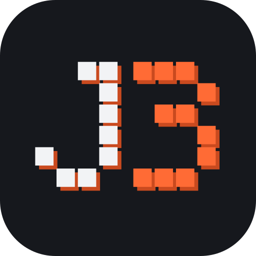
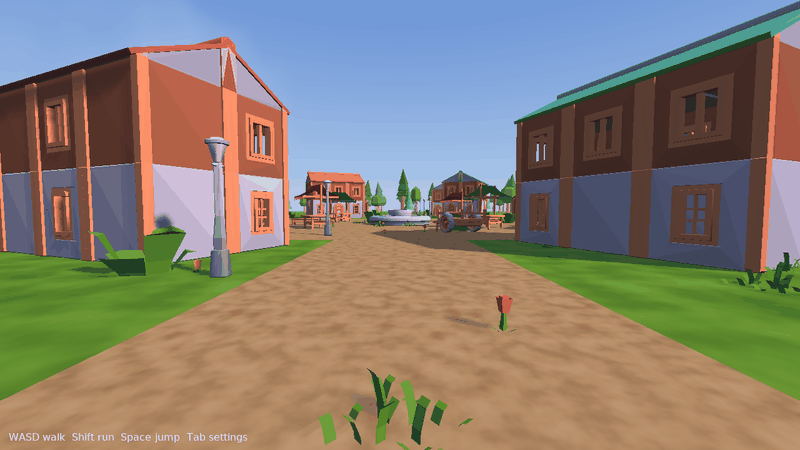
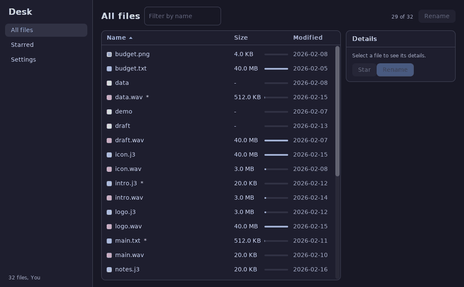
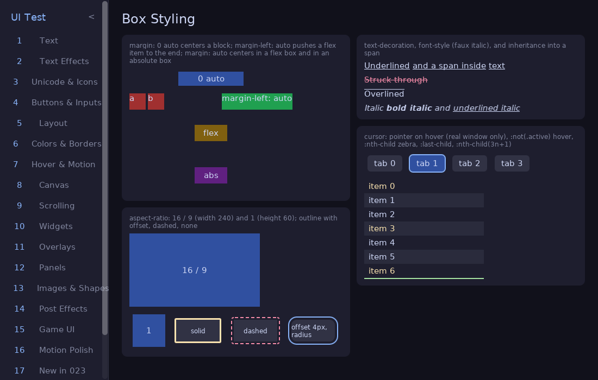

<p align="center"></p>

<h1 align="center">J3</h1>

<p align="center">
  A fast, ahead-of-time compiled language and engine for games and desktop apps.<br>
  Native binaries, HTML/CSS-style UI, a 3D scene editor, and docs built for you <i>and</i> your coding agent.
</p>

<p align="center">
  <a href="https://github.com/Jacoby-Y/j3/actions/workflows/ci.yml"></a>
  <a href="https://github.com/Jacoby-Y/j3/releases"></a>
  <a href="#license"></a>
  <a href="https://jacoby-y.github.io/j3"></a>
</p>

<p align="center">
  <a href="https://jacoby-y.github.io/j3">Book</a> ·
  <a href="#install">Install</a> ·
  <a href="examples">Examples</a> ·
  <a href="https://github.com/Jacoby-Y/j3/discussions">Discussions</a>
</p>

<p align="center"></p>

> **Status: alpha.** Linux (x86-64, arm64) is the main target; Windows, macOS, and Android are in progress. Anything can break before 1.0. A game made entirely in J3 is coming to Steam soon.

## Why J3

- **Fast to run, fast to build.** Compiles to native code through clang. Release builds are small (a large game ships in about 1.3 MB). A todo app builds from clean in 1.7 s and ships in 1.8 MB, next to 51 s and 3.4 MB for Tauri or 274 MB for Electron ([comparison](examples/ui_app_compare)).
- **One binary, no dependencies.** `j3c` is a single Rust crate with no crates. The compiler, standard library, docs, formatter, LSP, and editor all ship inside it.
- **UI with HTML/CSS syntax.** `.j3ui` components use Svelte-like markup and a large subset of CSS, compiled to native code. No browser, no webview.
- **A batteries-included game stdlib.** Windows, input, audio, 2D painting, 3D scenes, physics, ECS, pathfinding, shaders written in J3, threads, saves, JSON, HTTP/TLS.
- **Made for agents too.** `j3c doc` answers from the binary you run, and `j3c -e mcp` is an MCP server that lets Claude Code (or any MCP client) build, render, and check 3D scenes.
- **Ships for real.** `.deb`, zip, Steam (achievements, cloud, depots), and Android apk builds from `j3.toml`.

## A taste

```rust
module hello;

use j3.app.App;
use j3.game.{ Key, clear, drawRect, keyDown, rgb, setColor };
use j3.math.Vec2;
use j3.memory.Arena;

struct World { x: f32; }

fn boot(_mem: &Arena): World { return World { x: 280.0 }; }

fn update(w: &World, dt: f32) {
    if keyDown(Key.Left)  { w.x -= 200.0 * dt; }
    if keyDown(Key.Right) { w.x += 200.0 * dt; }
}

fn draw(w: &World) {
    setColor(rgb(32, 48, 72));
    clear();
    setColor(rgb(240, 200, 64));
    drawRect(Vec2 { x: w.x, y: 160.0 }, Vec2 { x: 80.0, y: 24.0 });
}

fn main() {
    let app = App<World>.create("hello", 640, 360, boot);
    app.always(update);
    app.draw(draw);
    app.run();
}
```

UI is a component file:

```svelte
<script>
    props { state: &State; }
</script>

<div class="app">
    <button on:click={state.clicks += 1}>Clicked {state.clicks} times</button>
</div>

<style>
    .app { display: flex; flex-direction: column; gap: 12px; padding: 12px; }
</style>
```

<p align="center">
  
  
</p>

## Install

```sh
curl -fsSL https://raw.githubusercontent.com/Jacoby-Y/j3/main/install.sh | sh
```

Or grab the `.deb` from [Releases](https://github.com/Jacoby-Y/j3/releases), or `yay -S j3c-bin` on Arch.

You also need clang and SDL2. `j3c doctor` tells you what's missing. On Ubuntu/Debian:

```sh
sudo apt install clang libsdl2-2.0-0 libsdl2-ttf-2.0-0 libsdl2-image-2.0-0 libsdl2-mixer-2.0-0 libgl1
```

From source (needs Rust + clang): `git clone https://github.com/Jacoby-Y/j3 && cd j3 && ./build.sh`

## Start

```sh
j3c new hello --app          # or --template fps, --template ui
cd hello
j3c run
```

`j3c guide` for the rest, `j3c doc` for the stdlib, `j3c doc recipes` for full example programs, and [the J3 book](https://jacoby-y.github.io/j3) for the language.

## Use it with an agent

```sh
claude mcp add -s user j3 -- j3c -e mcp
```

Your agent can then list, edit, place, render, and check scenes, and run the game headless. See [AGENTS.md](AGENTS.md) for how agents should work in this repo.

## Examples

In [`examples/`](examples). Run one with `j3c run examples/<name>`.

| Example | What it shows |
|---|---|
| [`editor_village`](examples/editor_village) | Scenes placing scenes, a walkable 3D village |
| [`desk-app`](examples/desk-app) | A desktop app in `.j3ui`: sortable table, modal, saved settings |
| [`big_ui_test`](examples/big_ui_test) | Every UI/CSS feature on its own page |
| [`terminal`](examples/terminal) | A terminal emulator on a pty |
| [`j2_script`](examples/j2_script) | A shooter whose content is moddable runtime scripts |
| [`openrouter-chat`](examples/openrouter-chat) | HTTPS + JSON + streaming in a console app |
| [`ui_app_compare`](examples/ui_app_compare) | One todo app in J3, Electron, Tauri, Wails, and Dioxus: build time and size |

## Contributing

Issues, ideas, and questions are welcome in [Discussions](https://github.com/Jacoby-Y/j3/discussions). See [CONTRIBUTING.md](CONTRIBUTING.md) and the [roadmap](roadmap.md).

## License

MIT or Apache-2.0. Third-party assets: [THIRD_PARTY.md](THIRD_PARTY.md).
